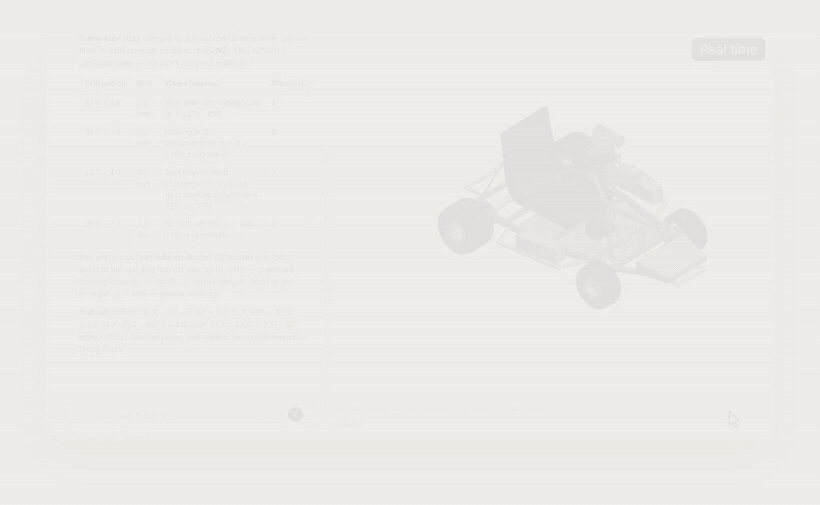
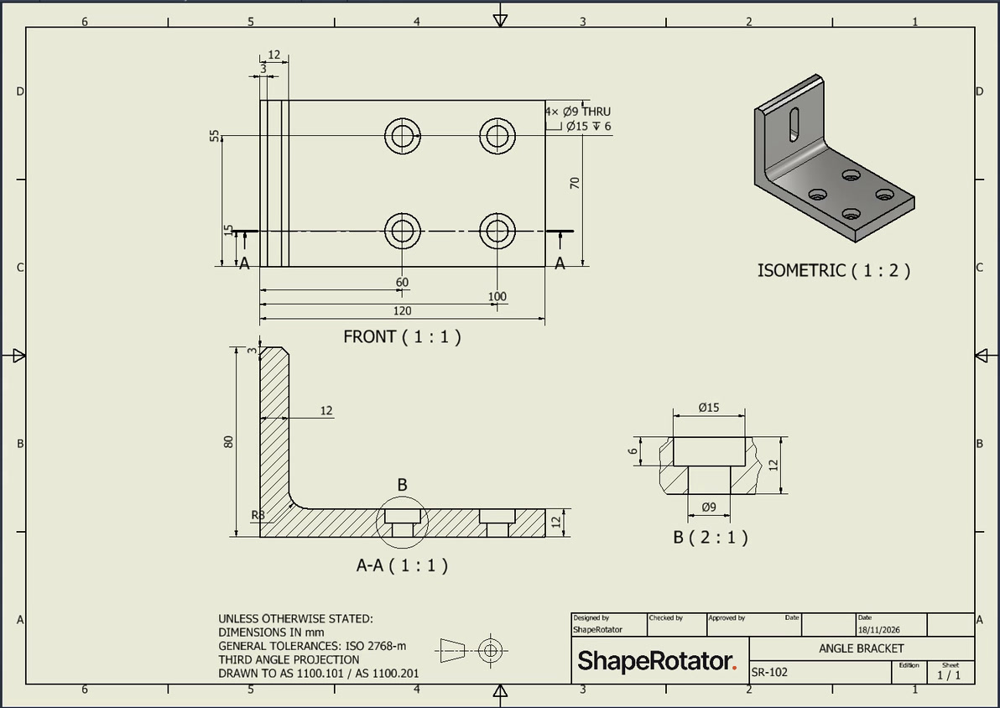
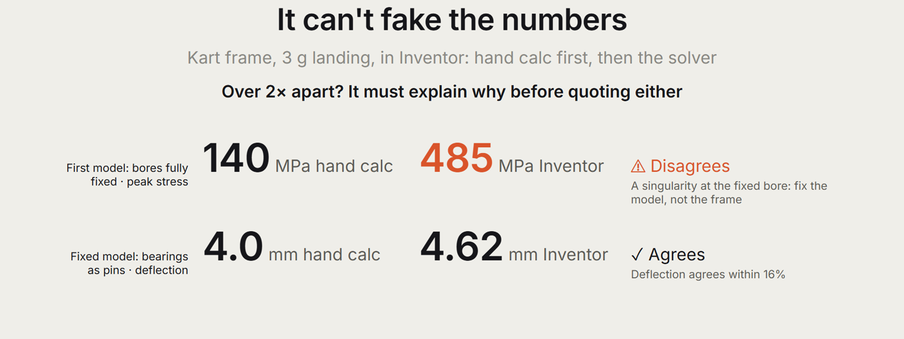
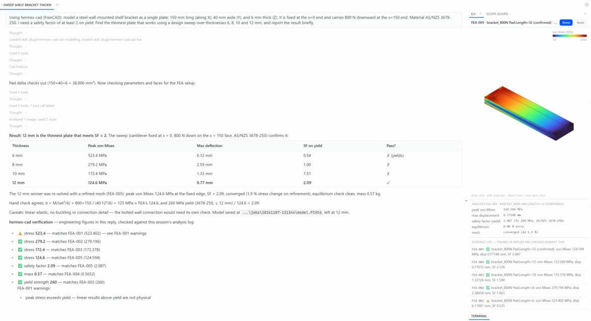

# ShapeRotator for Hermes (`hermes-shaperotator`)

ShapeRotator lets Hermes Agent design parts and assemblies in a real CAD program. Describe a part or a mechanism and
Hermes builds it as a parametric model, checks every feature against the geometry it intended, assembles the
components and produces drawings to the standard you choose. Engineering analysis is available when a design needs it,
and any stress, deflection or safety-factor figure the agent quotes is checked against the analyses it has run.



*A go-kart frame in the ShapeRotator pane. Clicking a tube places `@Face_25` in the chat, and Hermes answers from
the model's geometry (26.9 mm outside diameter, 2.3 mm wall).*


ShapeRotator provides the design workflow: modelling tools, drawings, the 3D pane, plans and the evidence log. The CAD
program behind it can be changed. FreeCAD is built in; Autodesk Inventor is driven through
[inventor-forge](https://github.com/RobertBarnettProjects/inventor-forge), an MCP server installed on first use with
your approval; other CAD programs can be added through their own MCP servers.

## Modelling

- **Parametric parts.** One toolset drives FreeCAD (headless, cross-platform) or Autodesk Inventor (Windows, through
  COM). Sketches are dimensioned, features are driven by named parameters, and every feature returns its change in
  volume and topology, so the agent compares each step with a hand calculation before continuing.
- **Assemblies.** On Inventor, components are placed and constrained, patterned, checked for interference and listed
  in a bill of materials with masses. Welded round-tube frames are built from 3D centre lines with a cut list
  (`tube_frame`, AS/NZS 1163 CHS sizes), and box-section frames from member centre lines.
- **Sheet metal, materials and properties.** Sheet-metal faces, flanges and flat patterns with DXF export; materials
  from Inventor's library, plus named grades the library lacks (`create_material`, for example C250L0); mass
  properties and iProperties.
- **Drawings.** Detail sheets and general arrangements to the chat's standard (template, projection angle, title block
  and projection symbol) on both backends. A QA check runs on each sheet, and PDF export waits until it reports no
  issues (`/cad force-export` overrides it once).
- **Standards.** The agent asks once per chat which standard to work to (AS 1100, ISO, ASME, DIN, BS 8888, JIS or GB)
  and applies it to drawings, fasteners and material suggestions.
- **The ShapeRotator pane in Hermes Desktop.** A live 3D view that refreshes after the agent's edits and after edits
  made by hand in Inventor; hover tooltips; clicking a face inserts a reference such as `@Face_12{near:[x,y,z]}` into
  the chat, and ctrl-click or lasso selects several; assembly components are coloured by kind, with a parts list for
  hiding components. The pane also shows plans, design history, deliverables, the evidence log and drawing previews.
  The 3D view meshes models with FreeCAD, so FreeCAD is required even when working in Inventor.
- **Inventor's full toolset.** `cad_native` reaches all 200+ inventor-forge tools by name: section and detail views,
  model states, parametric profiles, 3D-printing packages and the rest.

| | |
|---|---|
|  |  |
| A bracket detail drawing from a one-sentence request: section A-A, detail B, hole notes, AS 1100; the QA check passed before PDF export | The go-kart general arrangement: four views, a 23-item parts list and balloons |


*The same drawing workflow on the FreeCAD backend.*

## Analysis and verification

These features support design decisions once a model exists.

- **Analysis plans (`cad_plan`).** A requirement such as "survive a 3 g landing with a 120 kg driver, SF ≥ 2" becomes
  a plan: supports, loads with the arithmetic shown (120 kg × 3 g × 9.81 = 3,530 N), material, mesh and pass
  criteria, shown as editable cards in the pane. Nothing runs until you approve it.
- **Prediction before the solve.** The plan records the agent's hand calculation (formula, section modulus, load path)
  before the solver runs. Afterwards the two are compared: `CHECK OK` within a factor of two, otherwise
  `CHECK MISMATCH`, and the agent must explain the difference before quoting either figure.
- **Two solvers.** Inventor plans run in Inventor's Stress Analysis, which has no API and is driven with the mouse
  after you approve each run; they are also re-solved with CalculiX, which gives the pane an interactive stress field
  and an independent result. The FreeCAD route (FreeCAD FEM, second-order Gmsh tetrahedra, CalculiX) needs no mouse
  and reports an equilibrium check, an optional mesh-convergence re-solve and a yield safety factor.
- **Design sweeps.** `cad_fea(action="sweep")` solves several values of one dimension, selects the lightest design that
  meets the target safety factor and re-solves it with the convergence check.
- **Evidence log and claims check.** Each analysis is logged (FEA-001, FEA-002, …). After each reply, the stress,
  deflection, safety-factor and computed-mass figures it quotes are matched against the log, and a footer is
  appended: ✅ matches, ⚠️ matches a run with warnings or failed checks, ❌ contradicts the analysis, ❓ not backed by
  any analysis. The footer is appended; the reply itself is not changed.
- **Stress display.** Load arrows with their forces, support symbols, stress colours with palette, bands, range and a
  balanced or logarithmic scale, a yield threshold, animated deflection, and high-stress zones that become chat
  references such as `@HighStress_Zone_A`.



*The kart frame under a 3 g landing in Inventor. With the bearing bores fixed, the solver's 485 MPa peak disagreed
with the 140 MPa hand calculation, and the agent had to identify the singularity before quoting either figure. With
the bearings modelled as pins, the deflections agree within 16 %.*


*The same load case re-solved with CalculiX and shown in the pane: stress colours, the 3,530 N driver load and the
588 N battery-pack load on the faces they act on, and the supports in green.*



*A design sweep, with the verification footer on the reply.*

## Records and deliverables

- **Design history (`cad_history`).** Plan runs and Inventor analyses record versions V1, V2, … automatically, and
  `cad_history(action="checkpoint")` records any state. Each version has a diff, for example "wall 3 → 2.5 mm; mass
  15.9 → 13.6 kg (−14 %); SF 3.0 → 2.3".
- **Deliverables (`cad_artifact`).** A formal HTML and PDF report (model, loads and assumptions, results with their
  evidence identifiers, history, risk register, bill of materials, model references), a bill of materials as CSV, a
  risk register, and a `.hcad.zip` snapshot from which another Hermes user can continue the design.

## Install

```bash
hermes plugins install RobertBarnettProjects/hermes-shaperotator
hermes plugins enable hermes-shaperotator
```

In Hermes Desktop, enable the pane under **Capabilities → Plugins → hermes-shaperotator → Desktop**.

Requirements:

| | |
|---|---|
| FreeCAD 1.0+ | Required for the default backend, the 3D pane and FEA. Detected automatically (Windows `%LOCALAPPDATA%\Programs\FreeCAD *` and `Program Files`, the macOS app bundle, Linux `freecadcmd`), or set `freecad_path`. Includes Gmsh and CalculiX. |
| Autodesk Inventor 2024+ | Optional, Windows only. Its add-on, inventor-forge, is installed on first use as described below. |

**First use.** The first CAD chat detects the CAD programs installed on the computer, and the agent asks which one to
use; the answer is kept. A program that needs an add-on (Inventor needs inventor-forge) receives it through
`cad_backend(action='install')`. Hermes's approval prompt names the package, its source (a pinned commit of its
repository) and the destination folder. It is installed with pip into its own Python environment under the plugin's
data folder (`servers/<name>`), so Hermes's own environment is unchanged, and deleting that folder removes it. A plugin
release that moves the pin offers the update in the same way. The known programs are listed in `backends/known.json`.

Settings (in Hermes Desktop under **Capabilities → Plugins → hermes-shaperotator**, or
`plugins.entries.hermes-shaperotator.settings` in `config.yaml`):

| Setting | Meaning |
|---|---|
| `backend` | `freecad` or `inventor`. Empty: the agent asks on first use. |
| `freecad_path` | Folder containing FreeCAD's `bin` directory. |
| `standard` | A fixed standard for every chat (`AS1100`, `ISO`, `ASME`, `DIN`, `BS8888`, `JIS`, `GB`). Empty: the agent asks once per chat. |
| `job_dir` | Where models, previews and exports are written. |
| `inventor_visible` | Show the Inventor window when the plugin starts Inventor. |
| `server_sources` | For development: install a backend's server from a local checkout instead of its pinned commit, e.g. `{inventor: C:/src/inventor-forge}`. |

## Adding another CAD program

The workflow (modelling tools, drawings, plans, verification, the pane, history and deliverables) is built on a
backend-neutral contract (`core/backend.py`). FreeCAD and Inventor are built in. Any CAD program with an MCP server can
be added in configuration, without code:

```yaml
plugins:
  hermes-shaperotator:
    mcp_servers:
      inventor-mcp:                 # inventor-forge as a separate MCP server process
        command: [python, -m, inventor_forge.server]
        dialect: inventor-forge
      my-cad:                       # any other server that speaks MCP over stdio
        command: [node, my-cad-mcp.js]
        ops:                        # ShapeRotator operation -> that server's tool, with argument renames
          status: get_status
          extrude: {tool: pad, args: {distance: length}}
```

Select it with `cad_backend backend=my-cad`. Operations without a mapping fall back to a server tool of the same name,
and every server tool is available through `cad_native`.

A server can describe its tools to the plugin with a `cad/*` profile in each tool's `_meta` (defined in
inventor-forge's `profile.py`): which tools change the model's shape (the pane refreshes after them), which take over
the mouse and keyboard (the approval prompt states this), which run code (approval with the code shown), which
arguments name files the tool writes or reads (writes outside the job folder require approval), and how long a call
may take. While a call runs, MCP progress notifications extend its time limit up to twice the budget; a server that
sends none still times out. A server without a profile also works, with conservative defaults for each of these.
`tests/test_mcp_backend.py` exercises a stand-in CAD server in this way.

## Tools (toolset `cad`)

| Tool | Purpose |
|---|---|
| `cad_status`, `cad_backend` | Backend availability; switch or install a backend |
| `cad_document` | New part or assembly, open, save, close, export (STEP, STL, IGES, SAT, PDF) |
| `cad_sketch` | Rectangle, circle, line, polygon and closed profile on XY, XZ or YZ (with offset) or on a face |
| `cad_feature` | Extrude or cut, revolve, hole, fillet, chamfer, circular pattern, delete; returns the volume and topology change |
| `cad_inspect` | Mass properties, edge and face tables, find an edge or face, render a PNG |
| `cad_parameters` | Get, set and add driving parameters |
| `cad_standard` | The chat's standard: get, list, set |
| `cad_drawing` | Drawing sheets to the chat's standard, QA check, PDF export (gated on QA) |
| `cad_transaction` | Begin, commit or abort a group of operations |
| `cad_fea` | FEA run, face table, design sweep; materials, supports, force, pressure and gravity loads |
| `cad_python` | Runs Python inside the CAD program; requires approval for every call |
| `cad_native` | Inventor only: any inventor-forge tool by name. Its Python and PDF tools are redirected to `cad_python` and the gated export |

Slash command: `/cad status | backend <name> | preview | folder | force-export`.
Bundled skills: `hermes-shaperotator:cad-modelling`, `hermes-shaperotator:cad-fea`.

## Verification of quoted figures

```
cad_fea / cad_native analyze_stress  ──►  evidence log (FEA-001: vm_max 13.79 MPa, disp 0.00163 mm, SF 20.3, warnings …)
                                   │
agent reply ── transform_llm_output hook ── extract figures ── compare (2 % / rounding tolerance)
                                   │
                         footer: ✅ / ⚠️ / ❌ / ❓ per figure
```

Figures that are inputs, such as a given load or a plate thickness, are not treated as claims. Masses are checked only
when an analysis computed one. The footer is appended after the reply, so streaming is unaffected.

## Hooks

| Hook | Behaviour |
|---|---|
| `pre_tool_call` | Requests approval before `cad_python`; before installing a CAD program's add-on; before a server tool that deletes, runs code, takes over the mouse and keyboard or writes outside the job folder; and before a server tool that does not describe itself. Blocks drawing PDF export until the QA check is clean. |
| `post_tool_call` | After a geometry change, publishes the model to the Desktop pane (limited to about a fifth of build time, with a final update at the end of the reply). |
| `pre_llm_call` | Adds one line of CAD state (backend, last change, QA status). Until a CAD program is chosen, asks the model to offer the ones found on the computer. |
| `transform_llm_output` | Appends the verification footer when a reply quotes engineering figures. |
| `on_session_finalize` | Closes worker processes. |

## Disclosures

- **Local programs.** Starts FreeCAD's Python as a worker process (`freecad_path`), which runs Gmsh and CalculiX. On
  Windows it can drive Autodesk Inventor over COM. It starts a separate Inventor for each chat and closes it when the
  chat ends; an Inventor holding unsaved changes is shown and left open instead. An Inventor you have open is not used
  unless you ask for it.
- **Arbitrary code.** `cad_python` executes Python inside FreeCAD or Inventor with your user permissions. Every call
  goes through Hermes's approval prompt and is refused when nobody can answer. inventor-forge also has an
  `execute_python` tool; `cad_native` refuses it and directs the agent to `cad_python`.
- **Downloads.** `cad_backend(action='install')` downloads a CAD program's add-on server (inventor-forge from its GitHub
  repository at the commit pinned in `backends/known.json`, plus pywin32 from PyPI) and installs it with pip into its
  own environment under the plugin data folder. This happens once per program, always through Hermes's approval
  prompt, which names what is downloaded and where it goes, and is refused when nobody can answer. The pinned commit
  changes only with a new release of this plugin; nothing updates itself. Without git, GitHub's archive of the same
  commit is used, and pip refuses it unless its SHA-256 matches the one in `known.json`. pip runs isolated from your
  pip configuration; only proxy and certificate settings are passed to it. The `server_sources` setting installs from
  a source you name instead, such as a local checkout.
- **Background process.** Once installed and in use, the add-on runs as a child process (an MCP server over stdio)
  until the session ends or another CAD program is selected. It drives Inventor through COM and sends a progress
  message every 10 seconds during long calls.
- **Mouse and keyboard.** `cad_native analyze_stress` and `analyze_modes` drive Inventor's Stress Analysis, which has
  no API, by clicking faces in Inventor's viewport and typing into its dialogs for about half a minute. Each call goes
  through Hermes's approval prompt and is refused when nobody can answer. Every click is first checked to land on
  Inventor; otherwise the run stops. Inventor writes its HTML report to its working folder.
- **Files.** Reads files you name (`open`, STEP files for FEA) and writes models, renders, FEA working folders and
  exports to the session's job folder (or `job_dir`), plus paths you give to `save` and `export`. Paths are taken
  literally (no `~` or `$VAR` expansion, `..` refused, links resolved). A write outside the job folder requires
  approval in Hermes's prompt, which names the resolved path. Every call to the CAD add-on carries the folders and
  files it may write (`cad/write_scope`): the job folder plus any file outside it approved for that call.
  inventor-forge enforces this at each write, including the changed parts an assembly save also writes and a name
  that changes during the write (an added extension, a `.dwg` fallback), and refuses before writing anything else; the
  refusal names the files, and the next attempt asks you about them. Inventor itself writes its stress-analysis
  reports and solver scratch folders to its own working folders.
- **Reply footer.** Appends a verification footer to assistant messages that contain engineering figures. The text
  the model wrote is not changed.
- **Child processes.** Configured MCP commands, the FreeCAD worker and the headless browser run with your permissions
  and a minimal environment (what the operating system needs, plus a server's own `env` from configuration), without
  Hermes's provider keys. MCP servers are read only from the plugin's `mcp_servers` configuration. PDF reports are
  produced with a local Chrome or Edge browser in headless mode.
- **Polling.** The pane polls the plugin's backend route for scene data, and live sync polls Inventor for model
  changes.

## Limitations

- Analysis is linear-elastic with small deflections. Contact, plasticity, buckling, fatigue and code checks are not
  covered; the results support design decisions and are not a certification.
- The FreeCAD route analyses a single solid. Multi-body parts and assemblies are analysed in Inventor's Stress
  Analysis.
- Faces are selected by geometry, which is robust to renumbering; check the resolved faces that each run reports.

## Development

```bash
python -m venv .venv && .venv/Scripts/pip install pytest pyyaml fastapi
cd tests && ../.venv/Scripts/python -m pytest -q -c pytest.ini --rootdir . .
hermes plugins doctor . --ci
hermes plugins validate .
```

Tests that need FreeCAD are skipped when it is not installed.

## Credits

The Inventor backend is [inventor-forge](https://github.com/RobertBarnettProjects/inventor-forge) (MIT, same author),
installed on first use; `scripts/pin_backend.py inventor ../inventor-forge` moves the pin to a pushed commit. FreeCAD,
Gmsh and CalculiX are separate programs installed by the user. Licence: MIT.
