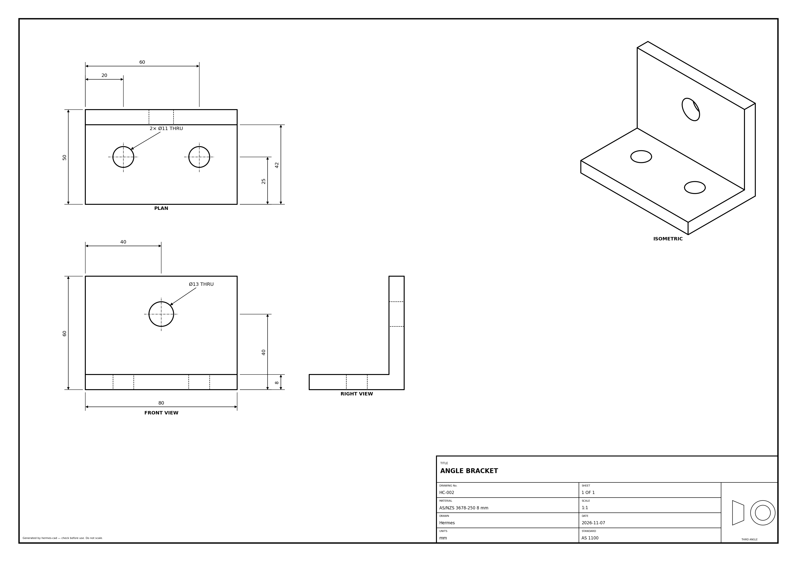
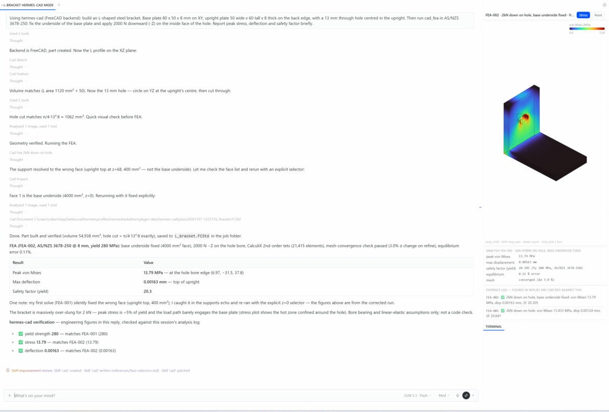
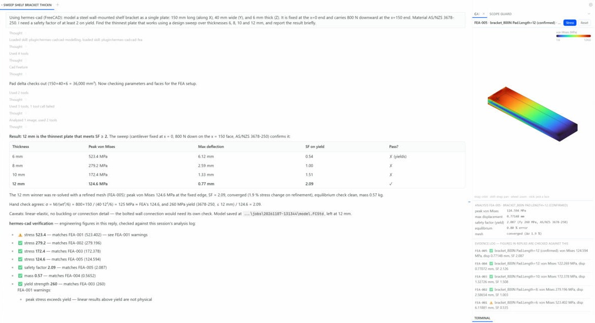

# ShapeRotator for Hermes (`hermes-shaperotator`) — verified engineering design

Describe what a part has to survive; Hermes designs it in your CAD, analyses it, and **flags any engineering
figure in its reply that no analysis backs**.

- **Parametric CAD** through one toolset: FreeCAD (headless, cross-platform; parts) or Autodesk Inventor (Windows,
  COM; parts, sheet metal, assemblies, drawings). Every feature returns a volume/topology delta, so the agent checks its
  own work against a hand calculation.
- **Conversational analysis (`cad_plan`):** "survive a 3 g landing with a 120 kg driver, SF ≥ 2" becomes a plan —
  supports, loads with the arithmetic shown (120 kg × 3 g × 9.81 = 3,530 N), material, mesh, pass criteria — shown as
  editable cards in the CAD pane. Nothing runs until you approve (in chat or with the card's button).
- **Predict, then check:** the plan carries the agent's own hand calculation (formula, section modulus, load path),
  written before the solve. After the run it is compared with the solver — `CHECK OK` within 2×, `CHECK MISMATCH`
  otherwise, and then the agent must explain the difference before quoting any number.
- **Two solvers:** Inventor plans run in Inventor's own Stress Analysis (driven with the mouse after you approve,
  because it has no API) and are re-solved with CalculiX, which gives the pane an interactive stress field and a
  second opinion. The FreeCAD route (FreeCAD FEM + Gmsh 2nd-order tets + CalculiX) needs no mouse; its runs report an
  equilibrium check, an optional mesh-convergence re-solve and a yield safety factor (AS/NZS steels or others).
- **Design sweep:** `cad_fea(action="sweep")` solves several values of one dimension and picks the lightest that meets
  the target SF on its first-pass mesh, then re-solves that design with the convergence check (check the confirmed
  figures it returns).
- **Design history (`cad_history`):** plan runs and Inventor analyses record V1, V2… automatically (and
  `cad_history(action="checkpoint")` records any state), each with a diff — "wall 3 → 2.5 mm; mass
  15.9 → 13.6 kg (−14 %); SF 3.0 → 2.3".
- **Deliverables (`cad_artifact`):** a formal HTML + PDF report (model, loads and assumptions, results with their
  evidence ids, history, risk register, BOM, model references), BOM CSV with mass, a risk register, and a `.hcad.zip`
  snapshot another Hermes user can load and continue from.
- **Evidence log + claims checker:** analyses are logged (FEA-001 …). After each reply, stress, deflection,
  safety-factor and computed-mass figures written in the usual forms ("116 MPa", "SF 2.1", "0.35 mm deflection") are
  matched against the log and a footer is appended: ✅ matches · ⚠️ matches a run with warnings or failed checks ·
  ❌ contradicts the analysis · ❓ not backed by any analysis. It flags; it doesn't rewrite the reply.
- **Standards, chosen per chat:** the agent asks once at the start (AS 1100, ISO, ASME, DIN, BS 8888, JIS or GB)
  and keeps the answer for the rest of the chat; drawings, fastener and material suggestions follow it.
- **Drawings:** sheets to the chat's standard (template, projection angle) with title block and projection symbol on both backends; a QA
  check runs on the sheet and PDF export waits for it to be clean (override once with `/cad force-export`).
- **Inventor automation:** the Inventor backend is [inventor-forge](https://github.com/RobertBarnettProjects/inventor-forge)
  (vendored in `backends/inventor/forge`); `cad_native` reaches its 160+ tools (sheet metal and flat patterns,
  assemblies, interference, BOM, materials, mass properties, section/detail views, Stress Analysis studies, load-case
  sweeps without the mouse once a study exists), including welded round-tube frames on 3D centre lines with a cut
  list (`tube_frame`, real AS/NZS 1163 CHS sizes), named grades the library lacks (`create_material`, e.g. C250L0)
  and appearances.
- **Any CAD program:** the workbench sits on a backend-neutral contract; a CAD MCP server is added in config and
  swapped with `cad_backend` (see below).
- **Hermes Desktop pane:** live 3D view (refreshes after the agent's edits, and after edits you make by hand in
  Inventor), hover tooltips, **click a face to drop `@Face_12{near:[x,y,z]}` into the chat**, ctrl-click / lasso to
  select several, assembly parts coloured by kind with a Parts list to hide components ("Frame only" before an
  analysis), Inventor-style load arrows (with the force) and support symbols, stress colours with palette, bands,
  range, a balanced/log scale so a peak doesn't paint everything blue, a Yield button and animated deflection, "zones above X"
  that become `@HighStress_Zone_A` references, a probe with "Ask Hermes about this spot", model info, plan cards,
  design history, artifacts, the evidence log, and drawing / Inventor-result previews. The 3D view meshes models with
  FreeCAD, so it needs FreeCAD installed even when you work in Inventor.





## Install

```bash
hermes plugins install RobertBarnettProjects/hermes-shaperotator
hermes plugins enable hermes-shaperotator
```

Then in Hermes Desktop: **Capabilities → Plugins → hermes-shaperotator → Desktop** switch on, to get the pane.

Requirements:

| | |
|---|---|
| FreeCAD 1.0+ | required for FEA and the default backend. Auto-detected (Windows `%LOCALAPPDATA%\Programs\FreeCAD *`, `Program Files`, macOS app bundle, Linux `freecadcmd`); or set `freecad_path`. Ships Gmsh and CalculiX. |
| Autodesk Inventor 2024+ | optional, Windows only (`pywin32` is installed with the plugin). |

Settings (Desktop: **Capabilities → Plugins → hermes-shaperotator**, or `plugins.entries.hermes-shaperotator.settings` in
`config.yaml`): `backend` (`freecad`/`inventor`), `freecad_path`, `standard` (optional: fixes the standard for every chat, e.g. `AS1100`, `ISO`, `ASME`, `DIN`,
`BS8888`, `JIS`, `GB`; leave it empty and the agent asks once per chat), `job_dir`, `inventor_visible`.

## Any CAD program: swap the MCP server

The workbench (plans, FEA verification, the viewport, history and artifacts) sits on a small
backend-neutral contract (`core/backend.py`). FreeCAD and Inventor are built in; **any CAD program
with an MCP server** can be added in config, without code:

```yaml
plugins:
  hermes-shaperotator:
    mcp_servers:
      inventor-mcp:                 # inventor-forge as a separate MCP server process
        command: [python, -m, inventor_forge.server]
        dialect: inventor-forge
      my-cad:                       # anything else that speaks MCP over stdio
        command: [node, my-cad-mcp.js]
        ops:                        # hermes-shaperotator op -> that server's tool (+ argument renames)
          status: get_status
          extrude: {tool: pad, args: {distance: length}}
```

Then `cad_backend backend=my-cad`. Unmapped ops fall back to a server tool of the same name, and
every server tool is reachable through `cad_native`. `tests/test_mcp_backend.py` drives a stand-in
CAD server this way. More programs (NX first) are planned.

## Tools (toolset `cad`)

| Tool | What it does |
|---|---|
| `cad_status`, `cad_backend` | backend availability / switch backend |
| `cad_document` | new part/assembly, open, save, close, export (STEP, STL, IGES, SAT, PDF) |
| `cad_sketch` | rect, circle, line, polygon, closed profile on XY/XZ/YZ (+offset) or a face |
| `cad_feature` | extrude/cut, revolve, hole, fillet, chamfer, circular pattern, delete — returns the delta |
| `cad_inspect` | mass properties, edges/faces tables, find edge/face, render a PNG |
| `cad_parameters` | get/set/add driving parameters |
| `cad_standard` | the chat's standard: get, list, set (asked once per chat) |
| `cad_drawing` | drawing sheets to the chat's standard, check, export PDF (gated) |
| `cad_transaction` | begin/commit/abort groups of operations |
| `cad_fea` | FEA run / face table / design sweep; materials, supports, force/pressure/gravity loads |
| `cad_python` | escape hatch: run Python inside the CAD app (**asks the user every time**) |
| `cad_native` | Inventor only: any inventor-forge tool by name (sheet metal, assemblies, materials, mass, analyze_stress / analyze_modes, drawing detail…); its Python and PDF tools are redirected to `cad_python` / the gated export |

Slash command: `/cad status | backend <name> | preview | folder | force-export`.
Bundled skills: `hermes-shaperotator:cad-modelling`, `hermes-shaperotator:cad-fea`.

## How the verification works

```
cad_fea / cad_native analyze_stress  ──►  evidence log (FEA-001: vm_max 13.79 MPa, disp 0.00163 mm, SF 20.3, warnings …)
                                   │
agent reply ── transform_llm_output hook ── extract figures ── compare (2 % / rounding tolerance)
                                   │
                         footer: ✅ / ⚠️ / ❌ / ❓ per figure
```

Figures that are inputs (the load you were given, a plate thickness) are not claims. Masses are only
reported when an analysis computed one. The footer is append-only, so streaming is unaffected.

## Hooks and what they do

| Hook | Behaviour |
|---|---|
| `pre_tool_call` | asks for approval before `cad_python`; blocks drawing PDF export until QA is clean |
| `post_tool_call` | after a geometry change, publishes the model to the Desktop pane (limited to about a fifth of build time; catches up at the end of the reply) |
| `pre_llm_call` | one line of CAD state (backend, last delta, QA status) so the model keeps its bearings |
| `transform_llm_output` | appends the verification footer when a reply quotes engineering figures |
| `on_session_finalize` | closes worker processes |

## Disclosures (risky behaviour)

- **Runs local programs:** starts FreeCAD's Python as a worker process (`freecad_path`), which runs Gmsh
  and CalculiX; on Windows can drive Autodesk Inventor over COM (it may start Inventor).
- **Arbitrary code (opt-in per call):** `cad_python` executes Python inside FreeCAD/Inventor with your user
  permissions. It always goes through Hermes's approval prompt (refused when nobody answers). The vendored
  inventor-forge also contains an `execute_python` tool; `cad_native` refuses it and points to `cad_python`.
- **Takes over the mouse and keyboard (opt-in per call):** `cad_native analyze_stress / analyze_modes` drive
  Inventor's Stress Analysis (which has no API) by clicking faces in Inventor's viewport and typing into its
  dialogs for about half a minute. Each call goes through Hermes's approval prompt (refused when nobody
  answers); every click is checked to land on Inventor first, otherwise the run stops. Inventor writes its
  HTML report to its working folder.
- **Files:** reads files you name (`open`, STEP for FEA) and writes models, renders, FEA working folders and
  exports under the plugin data folder (or `job_dir`), plus paths you give to `save`/`export`.
- **Modifies replies:** appends a verification footer to assistant messages that contain engineering
  figures (text only, appended — never edits what the model wrote).
- Configured MCP commands launch child processes with your permissions. They get a minimal environment (what the OS needs) plus the server's own `env` from config, not Hermes's provider keys; the same goes for the FreeCAD worker and the headless browser. MCP servers are read only from the plugin's `mcp_servers` config.
- Files the model writes go to the session's job folder. Paths are taken literally (no `~` or `$VAR` expansion, `..` refused, symlinks resolved); a write that lands outside the job folder asks you first in Hermes's approval prompt, naming the resolved path. The pane polls the plugin's backend route for scene data. Live sync polls Inventor for model changes. PDF report generation launches a local Chrome or Edge browser in headless mode.

## Limits (honest)

- Linear-elastic, small-deflection, single solid. No contact, plasticity, buckling, fatigue or code checks;
  the FEA is a design aid, not certification.
- Assemblies / multi-body need bonded contacts → not analysed yet.
- Geometric selectors are robust to renumbering, but always check the resolved faces the run echoes.

## Development

```bash
python -m venv .venv && .venv/Scripts/pip install pytest pyyaml fastapi
cd tests && ../.venv/Scripts/python -m pytest -q -c pytest.ini --rootdir . .
hermes plugins doctor . --ci
hermes plugins validate .
```

Tests that need FreeCAD skip when it isn't installed.

## Credits

The Inventor backend is [inventor-forge](https://github.com/RobertBarnettProjects/inventor-forge) (MIT, same author),
vendored in `backends/inventor/forge` (refresh with its `scripts/vendor_into_hermes_shaperotator.py`). FreeCAD, Gmsh
and CalculiX are separate programs installed by the user. Licence: MIT.
